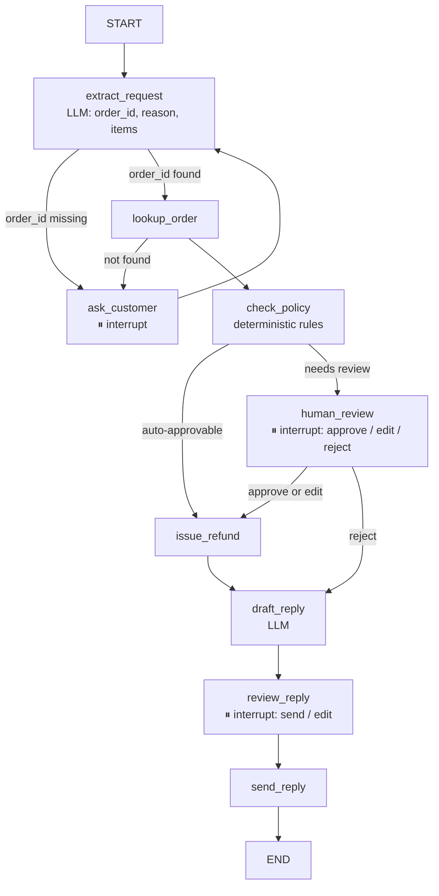

# Exercise 1 — Refund Desk Agent with Human-in-the-Loop (LangGraph)

## Scenario

You work at **ShopFast**, a mid-size online store. The support team gets hundreds of
refund requests a day. Leadership wants an agent that handles the easy ones end-to-end,
but **finance insists a human signs off on anything risky**, and **support leads want to
review every outgoing customer email** until they trust the agent.

You will build that agent as a LangGraph `StateGraph` that pauses for people at the
right moments, survives restarts, and never refunds the same order twice.

## What you'll practice

| Concept | Where it shows up |
|---|---|
| `interrupt()` + `Command(resume=...)` | Pausing for a reviewer, an email editor, and the customer |
| Checkpointers + `thread_id` | Each ticket is one thread; a pause can last hours |
| Conditional routing | Auto-approve vs. human review; missing info vs. continue |
| Structured output from an LLM | Pulling `order_id` / reason / items out of a messy email |
| Side effects and replay safety | Why `issue_refund` must not re-run when a node resumes |
| Durable resume (stretch) | Kill the process mid-review, restart, carry on |

## The workflow



There are three pauses, and each one is a different kind of human-in-the-loop:

1. **`ask_customer`**: *collect missing input.* The graph asks the customer a question
   and waits for the answer.
2. **`human_review`**: *approve, edit, or reject an action.* A finance reviewer sees
   the agent's recommendation and decides.
3. **`review_reply`**: *review generated content.* A support lead approves or rewrites
   the email before it goes out.

## Refund policy (implement in `check_policy`, no LLM)

`TODAY` is fixed in `orders.py` so results are deterministic.

1. **Final-sale** items are not refundable → recommendation `reject`.
2. Item reported **damaged / defective** → full refund to the original payment method,
   no matter how many days have passed.
3. ≤ **30 days** since delivery → full refund to the original payment method.
4. **31–60 days** → refund as **store credit** only.
5. **> 60 days** → recommendation `reject`.

**Auto-approve** only when *all* of these hold. Anything else goes to `human_review`.
- the recommendation is not `reject`
- refund amount ≤ **$100**
- the customer has **fewer than 3** refunds in the last 90 days

## Interrupt payload contract

Your nodes and your CLI driver (`main.py`) must agree on these shapes. Every interrupt
payload carries a `"type"` so the driver knows what to show.

```python
# ask_customer
interrupt({"type": "ask_customer", "question": "Could you share your order number?"})
# resume with: "It's SF-1002"                       (str)

# human_review
interrupt({"type": "human_review", "order_id": ..., "amount": ..., "method": ...,
           "recommendation": ..., "reasons": [...], "customer_message": ...})
# resume with one of:
#   {"action": "approve"}
#   {"action": "edit", "amount": 60.0, "method": "store_credit"}
#   {"action": "reject", "reason": "Final sale item"}

# review_reply
interrupt({"type": "review_reply", "to": ..., "subject": ..., "body": ...})
# resume with: {"action": "send"}  or  {"action": "edit", "body": "..."}
```

## Milestones

Work through these in order. Each milestone should run before you start the next.

### M1 — Skeleton (no LLM, no interrupts)
- Define `RefundState` in `state.py`.
- Stub every node so it returns hard-coded values. Wire the full graph in `graph.py`
  with all conditional edges.
- Call `graph.get_graph().draw_mermaid()` and compare it with the diagram above.

### M2 — Real logic
- `extract_request`: use `llm.with_structured_output(...)` with a Pydantic model
  (`order_id: str | None`, `reason`, `damaged: bool`, `item_skus: list[str]`).
- `lookup_order` and `check_policy`: use `orders.py`.
- `issue_refund` and `send_reply`: call `orders.issue_refund` and `orders.send_email`.

### M3 — Human in the loop
- Add the three `interrupt()` calls.
- Compile with `InMemorySaver()` and run each ticket on its own `thread_id`.
- Finish `main.py`: while the result contains `__interrupt__`, show the payload, collect
  input, and resume with `graph.invoke(Command(resume=answer), config)`.

### M4 — Replay safety
When a graph resumes, **the interrupted node runs again from its first line**.
- Prove it: put a `print("human_review entered")` *before* the `interrupt()` call and
  watch it print twice.
- Make sure no side effect (refund, email, ledger write) can run twice. Two things
  should guarantee that: side effects live in their own nodes *after* the interrupt,
  and `issue_refund` is called with an idempotency key (for example
  `f"{thread_id}:{order_id}"`).

### M5 — Audit trail
Finance wants to know who approved what. Add an `audit_log: Annotated[list[dict], operator.add]`
field. Every decision (auto-approve, human approve/edit/reject, email edited) appends
`{"step", "decision", "by", "details"}`. Print it at the end of each run.

## Acceptance scenarios

The tickets are in `tickets.py`. Run each one on its own thread.

| Ticket | Expected path | Expected outcome |
|---|---|---|
| `T1` mug, 5 days, $18 | auto-approve → reply review | 1 refund of $18 to `original_payment`, 0 human reviews |
| `T2` laptop, 10 days, $449 | human_review → **approve** | 1 refund of $449 |
| `T3` no order number | ask_customer (answer `SF-1002`) → human_review | Continues as T2 after the answer |
| `T4` jacket, 45 days, $120 | human_review → **edit** to $60 store credit | 1 refund of $60 `store_credit` |
| `T5` final-sale sneakers | human_review → **reject** | **0** refunds; the email explains the policy |
| `T6` headphones, $89, flagged customer | human_review (despite < $100) | Reviewer decides |
| `T7` damaged blender, 75 days | human_review (amount > $100) | Recommendation is a full refund even though it's past 60 days |

**Global checks:** after running all tickets, `orders.REFUND_LEDGER` holds exactly one
entry per approved **order**, and `orders.OUTBOX` holds exactly one email per ticket.
T2 and T3 are the same customer asking about the same order (SF-1002), so running both
should refund SF-1002 only once.

## Stretch goals

1. **Durable pause.** Swap `InMemorySaver` for `SqliteSaver`
   (`uv add langgraph-checkpoint-sqlite`). Stop the program while it's paused at
   `human_review`, restart it with `python main.py --resume <thread_id>`, and finish the
   ticket.
2. **Review queue.** Run all tickets first and collect every pending interrupt into a
   queue. Then let the reviewer work through the queue in any order. This is how a real
   back-office tool works.
3. **Time-travel fix.** After a ticket finishes, use `graph.get_state_history(config)` to
   find the checkpoint before `human_review`. Fork from it with different reviewer input.
4. **Tests without an API key.** Write pytest tests with `GenericFakeChatModel` from
   `langchain_core.language_models.fake_chat_models` so the LLM nodes are deterministic.
5. **Escalation timeout.** If a review stays pending for more than N hours, route it to a
   `escalate_to_manager` interrupt instead. Store the time the review was requested in
   state.

## Setup

Run these from this folder. Dependencies are already installed in `.venv`.

```bash
cp ../reflexion-agent/.env .env
```

```bash
uv run main.py T1
```

Copying the `.env` reuses your `OPENROUTER_API_KEY` and LangSmith settings. Until the
key is there, importing `llm.py` fails with "Missing credentials".

## Hints (read only when stuck)

<details><summary>Routing after an interrupt</summary>

You can return `Command(goto="issue_refund", update={...})` from `human_review` instead
of adding a conditional edge. Pick one style and use it everywhere.
</details>

<details><summary>Why did my refund fire twice?</summary>

Something with a side effect runs in the same node as `interrupt()` and comes *before*
it. On resume, LangGraph re-runs that node from the top.
</details>

<details><summary>Multiple interrupts in one node</summary>

Interrupts inside one node are matched to resume values **by order**. Don't put
`interrupt()` inside conditional branches whose order can change between runs.
</details>

<details><summary>The free model returns bad structured output</summary>

Set `LLM_MODEL` in `.env` to a model that supports tool calling, or wrap the call in a
retry that falls back to `order_id=None` (which routes to `ask_customer`, a safe default).
</details>
